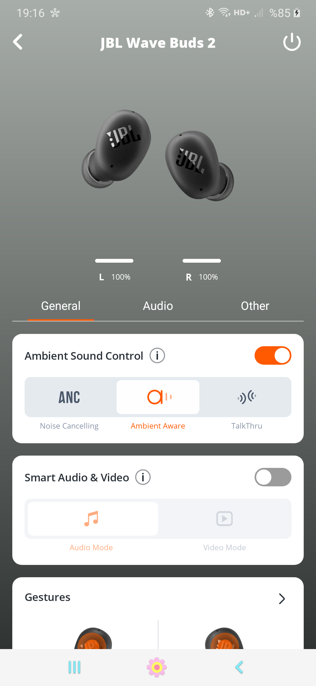

# JBL Wave Buds 2 — firmware & OTA reverse engineering

[](https://github.com/c8dhjp4tyv-bit/jbl-wave-buds2-firmware-research/actions/workflows/tests.yml)

Reverse-engineering notes and reproducible tooling for the JBL Wave Buds 2
(Bestechnic **BES1306**, PID `2100`): the on-flash layout, the OTA container
format down to the byte, the BLE/GATT command protocol and the BES "TOTA v2"
encrypted transport, the device- and app-side trust boundaries, the factory
console, and a reproducible method for loading a self-built image onto a unit you
own.

The analysis spans two builds — the IDA-analyzed `wavebuds.elf` (Apr 2025) and
the distribution package `2.9.0` (Sep 2026) — a fully specified 8-stream OTA
container (verified by byte-identical repack), the CRC-32 integrity model
confirmed on both the app and device sides, a 54/59-entry factory command table,
12 OTA RAM state variables, a 7,960-function enumeration, and a cross-build
differential. Semantic recovery is deep for the OTA/flash/CRC/factory subsystems
and enumeration-only elsewhere — see the [completeness audit](docs/COMPLETENESS_AUDIT.md).

> [!WARNING]
> This is owner-performed hardware research, not an official JBL update. Flashing
> a modified image is irreversible: the download phase is staged and brick-safe,
> but activation of a CRC-valid-but-broken image has **no exposed recovery path**.
> Read [SAFETY.md](SAFETY.md) before reproducing anything.

Türkçe sürüm: [README.tr.md](README.tr.md)



*Hardware result on the tested unit: after the app + user-CA MITM OTA pipeline was
validated, both earbuds connect, report 100%, and every app control (ANC/Ambient,
gestures, EQ) works. When the one-byte-modified package was supplied, the owner
reported update success, reboot, and normal operation. The changed byte was not
read back from the device; this is a health observation, not proof of which
image executed.*

## Confirmed findings

Addresses are from the analyzed build (`wavebuds.elf`); see the
[address ledger](docs/ADDRESS_LEDGER.md) and [provenance](docs/PROVENANCE.md).

- The inspected application OTA handler uses **CRC-32 integrity checks**, with
  no firmware signature verification identified in that path. The handler
  `0x2C0918BC` checks config, each segment, and the
  whole image with the CRC-32 routine `0x2C0CE944` (table `0x2C0F5218`) plus a
  `"BEST"` magic. The one-byte-modified package produced a reported successful
  update; execution of the modified byte and ROM checks remain unverified.
- The app's RSA-2048 verifier (`com.jbl.counterfeit.Rsa2048DynamicVerifier`) is
  **anti-counterfeit** (device authenticity), not firmware signing.
- In the tested **patched-app** OTA flow, certificate pinning did not block the
  local proxy. The stock app trusts system CAs only; a user-installed CA requires
  changing the owner's app network security configuration.
- OTA is **staged**: the new image is written to flash base `0x28120000` while
  the running application remains intact. This reduces download-phase risk but
  does not guarantee recovery from a bad update.
- An external BLE central **cannot drive** OTA: the handlers are gated on an
  internal TWS/connection state (`0x2C0905E4`: `MEMORY[0x20026BA0] ∈ {2,4}`).
- The BES **TOTA v2** transport derives its AES-128 session key entirely
  client-side; there is no server/device secret.
- A **factory/engineering console** (59 commands in the analyzed build, 54 in
  2.9.0) can read/write device identity (MAC/BLE address), crystal trim, and the
  BT link key. Its over-the-air reachability is `UNRESOLVED`.
- The two builds are **separately compiled and relocated**: same product, shifted
  addresses, 59 → 54 factory entries. See the [differential](docs/PROVENANCE.md).

## Tested modification

The modification is intentionally minimal — one byte of the decompressed image.
The `RTX V5.5.1` marker starts at decompressed offset `64096`; its final digit
was changed at offset `64105` (`0xFA69`) to produce `V5.5.2`, and the container
CRC-32 was recomputed. It is cosmetic by design: the
point is to test the delivery of a modified-but-CRC-valid image without changing
behavior. The owner reported success and normal operation, but the modified
marker was not read back; see [the validation boundary](docs/VALIDATION.md#hardware-validation-boundary).

```text
Base (owner-supplied; not redistributed)
  official 2.9.0 package   549,558 bytes   SHA-256 836cb251f9fb2261dde14f39ba18d358c48018817f3c3d1b527e1ac5f3ab7ba2
  decompressed image       955,596 bytes   SHA-256 489663e80b76f20f4c94671064908569fac5f4e3df10ab6d7369baffe094f67d
  container CRC-32          A0C7CCEC (valid), input range [0x0, 0x862AD)
```

The repository intentionally contains **no JBL firmware**. Supply your own
legally obtained package and reproduce:

```bash
python3 tools/ota_unpack.py  <official_2.9.0_package.bin> --extract image.bin
python3 tools/ota_repack.py  make-test <official_2.9.0_package.bin> test.bin
python3 tools/ota_unpack.py  test.bin      # exactly one decompressed byte differs; CRC valid
```

The repacked container's exact bytes depend on the LZMA encoder; the device
verifies **CRC-32, not a package hash** (see [docs/04](docs/04-security-model.md)),
and the one-byte decompressed diff is deterministic. Delivery through the app is
in [docs/08](docs/08-delivery-method.md).

## Diagrams

| | |
|---|---|
| [Flash map](docs/images/flash-map.svg) | 2 MB NOR partitioning |
| [OTA command flow](docs/images/ota-flow.svg) | the sequence and its CRC-32 checkpoints |
| [Trust boundaries](docs/images/trust-boundaries.svg) | what each stage verifies, and where image trust rests |

## Documentation

- [00 — Overview](docs/00-overview.md)
- [01 — Hardware & flash map](docs/01-hardware-flash-map.md)
- [02 — OTA container format](docs/02-ota-container-format.md)
- [03 — Firmware image layout](docs/03-firmware-image-layout.md)
- [04 — Security model](docs/04-security-model.md)
- [05 — BLE/GATT & commands](docs/05-ble-gatt-and-commands.md)
- [06 — OTA protocol](docs/06-ota-protocol.md)
- [07 — App-side analysis](docs/07-app-side-analysis.md)
- [08 — Delivery method](docs/08-delivery-method.md)
- [09 — Function catalogue](docs/09-function-catalog.md)
- [10 — Factory console](docs/10-factory-console.md)
- [Provenance (two builds, evidence classes)](docs/PROVENANCE.md) · [Address ledger](docs/ADDRESS_LEDGER.md)
- [Completeness audit](docs/COMPLETENESS_AUDIT.md) · [Coverage & limitations](docs/COVERAGE_AND_LIMITATIONS.md)
- [State machines](docs/STATE_MACHINES.md) · [Incidents](docs/INCIDENTS.md)
- [Tools & scope](docs/TOOLS.md) · [Testing & reproducibility](docs/VALIDATION.md)
- [Generated catalogs](docs/generated/README.md) · [IDA command log](analysis/IDA_MCP_COMMAND_LOG.md)

## What this project does not claim

- It does not redistribute JBL firmware, the app (original or modified), or a
  ready-to-flash custom image.
- The documented build helper does not alter the device-authenticity
  (anti-counterfeit) path.
- It does not prove the ROM bootloader lacks secure boot — that region is outside
  every OTA image and was not dumped. Evidence is limited to the inspected
  application OTA path and owner-reported update success on one unit, without
  readback of the modified byte.
- It does not claim the factory console is reachable over the air.
- It does not claim any result holds for another unit, region, or firmware build.

## Contributing, security, and citation

Contributions must preserve build provenance and ship no firmware; see
[CONTRIBUTING.md](CONTRIBUTING.md) and [SAFETY.md](SAFETY.md). Security-relevant
findings follow [SECURITY.md](SECURITY.md). Citation metadata is in
[CITATION.cff](CITATION.cff); cite the exact commit or tag used.

## License

Scripts are [MIT](LICENSE); documentation is CC-BY-4.0. JBL/Harman firmware,
trademarks, and app assets remain the property of their owners and are not
redistributed here.

## Star History

<a href="https://www.star-history.com/?type=date&repos=c8dhjp4tyv-bit%2Fjbl-wave-buds2-firmware-research">
 <picture>
   <source media="(prefers-color-scheme: dark)" srcset="https://api.star-history.com/chart?repos=c8dhjp4tyv-bit/jbl-wave-buds2-firmware-research&type=date&theme=dark&legend=top-left" />
   <source media="(prefers-color-scheme: light)" srcset="https://api.star-history.com/chart?repos=c8dhjp4tyv-bit/jbl-wave-buds2-firmware-research&type=date&legend=top-left" />
   
 </picture>
</a>
